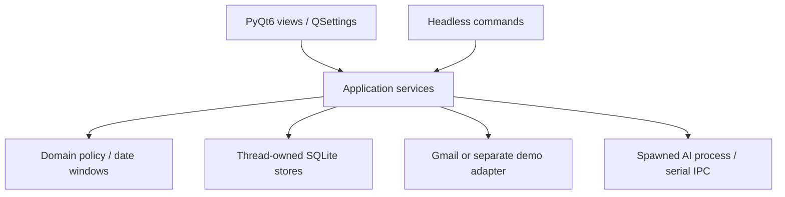
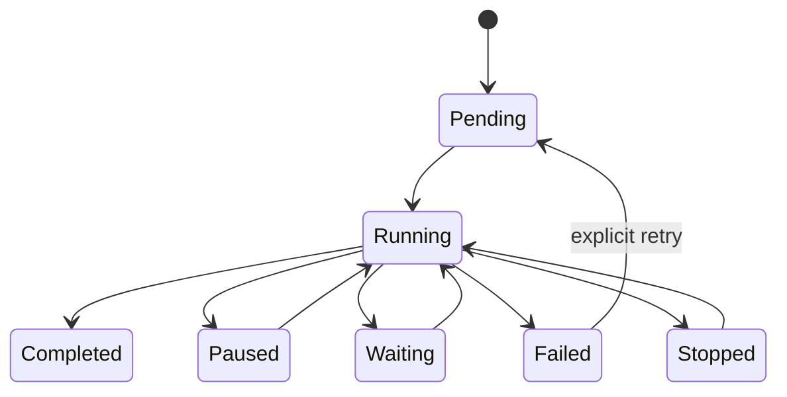

# Architecture, persistence, and recovery

## Components

`domain.py` contains configuration, messages, assessments, frozen windows, canonical hashes, calendar arithmetic, and deterministic recommendations. `gmail.py`, `auth.py`, and `mime.py` implement real Gmail integration and body parsing. `demo.py` supplies a synthetic mailbox; `demo_ai.py` implements the exact external-module surface without network calls. `ai.py` owns prompts, strict response validation, module isolation, and structured error transport. `storage.py` owns schema migrations and thread-affine SQLite access; `learning.py` manages feedback, examples, and rules. `jobs.py` coordinates durable discovery/retrieval/classification. `stage_cache.py` covers read-stage snapshot reuse with complete Gmail history intervals; it never supplies an execution preflight. Application/action services compose those parts; the GUI and CLI call the same core behavior.

`gui.py` preserves the desktop import surface. `gui_window.py` owns the window workflow, `gui_preferences.py` owns preferences/settings and instance locking, `gui_preview.py` owns safe previews, `gui_workers.py` owns task signals and worker cleanup, and `gui_dialogs.py` owns label/rule dialogs. The extraction preserves the existing class/function behavior and comments; characterization tests cover the public facade and durable stop behavior.

Live Gmail HTTP clients and database connections belong to their worker. A resource owner shares one lock-protected credential session: workers build separate transports, synchronize refresh, and persist only a rotated refresh token. Disconnect, reconnect, and observed connection-generation changes fence obsolete sessions, including refreshes still in flight. GUI signals carry results back to the main Qt thread. The application reuses isolated AI clients between tasks; calls remain serialized, and a worker closes only its own SQLite connection. The AI child process has no SQLite connection: it loads one module, processes serializable requests sequentially, and returns text/metadata or a typed error record over IPC. Local termination is recorded as interrupted work, not proof that a remote provider canceled billing. The offline DemoMailbox has a synchronized API and can be shared across tasks without repeatedly parsing its state file.

Large tables use SQL filtering/sorting and bounded LRU page caches. They do not create widgets for every record or sort 50,000 cached bodies through an in-memory proxy. Message previews render literal plain text and block all resource loading and active content. Open in Gmail remains an explicit navigation action.

## Runtime locations and account isolation

Default Windows base: `%LOCALAPPDATA%\GmailInboxCleaner\`. Linux uses `$XDG_DATA_HOME/GmailInboxCleaner/`, falling back to `~/.local/share/GmailInboxCleaner/`; macOS uses `~/Library/Application Support/GmailInboxCleaner/`. **`demo`** and **`live`** subdirectories are always separate; a custom `--data-dir` base also receives the appropriate mode subdirectory.

- `mailbox-<account SHA-256 prefix>.sqlite`: account-bound operational database, with SQLite WAL/SHM sidecars while open.
- `unconnected.sqlite`: disconnected UI state before selecting an account.
- `account.json`: account identity only; it is not a token store.
- `demo-mailbox.json`: synthetic mailbox state used exclusively by demo mode.
- QSettings organization `GmailInboxCleaner`, application `Demo` or `Personal`: configuration and layout preferences. QSettings uses the platform's persistence mechanism; it does not provide secret encryption.
- Credential Manager or per-user DPAPI file: protected credential payload, separate from preferences and mailbox cache.

A database binds to one authenticated account. Operational tables retain the account ID; constraints/triggers reject cross-account rows. Every forward execution verifies the connected identity. A different account receives its own database and cannot silently reuse another account's plan. Demo adapters never construct a real Gmail service.

`QLockFile` prevents a second normal GUI/headless instance from owning a mode directory. SQLite `job_leases` separates `mailbox_runner` (one discovery/classification runner) from `mailbox_execution` (one mailbox writer), with PID, process creation identity, heartbeat, expiry, owner token, and generation. Metadata/body batches and classification result commits briefly share the writer fence, but provider calls release it. Explicit Apply and Undo use the independent desktop pool and can proceed while AI classification is waiting; two writers remain excluded. Ownership is checked inside recovery transactions so a delayed fenced runner cannot pause or requeue a successor's job. A durable writer revision causes an in-flight AI result to be discarded and preflight repeated if an explicit write intervened, preserving receipts and current label state. Auto-execution still acquires the same writer lease. Lease repair snapshots and fences both observed leases; it cannot break a successor with a new owner token. A dedicated thread-owned connection renews leases during slow network calls. Dead/reused PIDs and expired leases can be recovered; token checks fence the previous owner before later writes. Confirmed lease repair is a separate metadata-only CLI operation that exits without opening Gmail or bypassing the instance lock for execution. The GUI repair uses its own local control pool so it remains available when both the cleanup runner and a mailbox writer are blocked. An already in-flight remote request may still complete. Each worker owns its Store with `foreign_keys=ON`, `busy_timeout=5000`, WAL, and `synchronous=FULL`.

## Schema

Schema migrations use `PRAGMA user_version`; the current schema is version 7. Version 4 indexes normalized List-ID, version 5 adds process creation identity, version 6 installs account triggers once, and version 7 removes duplicate body JSON and adds independent body-cache age. Existing databases receive a verified pre-migration backup before a transactional upgrade. After a successful upgrade, only the newest two pre-migration snapshots for that database are retained; `Store(migration_backup_count=N)` can set another positive retention count. Failed upgrades retain every recovery snapshot, and manual/pre-restore backups are never pruned by this policy. These snapshots contain cached mail and require the same private storage as the database. Newer unsupported schemas are rejected. The body column is authoritative; other structured/versioned details remain in JSON beside indexed queue/UI fields.

| Table | Purpose / indexed relationships |
| --- | --- |
| `accounts` | Bound mailbox identity and local first/last observation timestamps. |
| `labels` | Gmail ID identity, user/system type, current name, meaning, deletion marker; names are not identity. |
| `messages` | Explicit message/thread IDs, millisecond internalDate, headers/labels, optional normalized body, truncation/missing flags, hashes, inbox state, recommendation, deadline/defer. Indexes cover inbox/date, thread, sender, decision, due dates. |
| `jobs` | Frozen anchor, window, effective configuration, state/stage, resumable discovery payload. |
| `work_items` | Durable candidate/stage manifest, unique `(job_id,message_id,stage)`, retry attempts, next attempt, sanitized error, input version. |
| `checkpoints` | History ID, boundary sweep, reconciliation, and resumable page state. |
| `predictions` | Structured assessment independent of recommendation, content/context/policy/model/prompt/example versions, validity and reason. |
| `actions` | Explicit message-level proposal, minimal additions/removals, preconditions, approval source, before/after receipts, undo links, state. |
| `attempts` | Persisted attempt before each write, before/after relevant state, known/unknown outcome, error. |
| `errors` | Stage/item failure identity, sanitized class/summary, attempts and retry time. |
| `feedback` | Explicit action/category feedback, source/reason/scope, bulk group ID, context and prediction versions, corrections/supersession, learning inclusion. |
| `manual_overrides` | Current-item context-bound decisions and deferrals, retained independently from learned examples. |
| `examples` | Selected learning evidence, category/sender/list/template keys, separate action/label semantics, group identity and weight. |
| `pattern_stats` | Rebuilt independent support/counterexample counts by pattern/action. |
| `rules` | Conditions, action, selected labels, explicit/inferred source, enabled state, revision, support/counterexamples. |
| `job_leases` | Recoverable execution ownership, PID/process creation identity, heartbeat, expiry and generation. |

All operational timestamps are UTC. Message age uses Gmail `internalDate`; `updated_at` is a local observation time. No historical read/open timestamps are invented. Gmail `UNREAD` is only current state; a history event does not identify the actor.

## Job discovery and synchronization

A job freezes its resolved bounds and anchor when created. A unique durable manifest deduplicates IDs before any forward write. Enumeration is not an atomic Gmail snapshot; the job captures synchronization state, enumerates IDs, and reconciles intervening history.

Maintenance performs:

1. History from the stored start ID, processing specific message-added/deleted and label-added/removed event arrays. Removing `INBOX` must not be lost through an overly narrow history filter.
2. A rolling examination-boundary sweep from the prior exclusive endpoint to the new one, with a 24-hour search safety margin. Exact millisecond bounds are enforced locally.
3. Local inbox reconsideration for age/deadline/defer transitions, reusing valid assessments. Periodic full reconciliation repairs missed or expired history.

A page token is a resumable optimization, not a positional offset. Invalid tokens trigger bounded safe re-enumeration with deduplication. Expired history triggers reconciliation rather than deleting local data. Page IDs, work items, and checkpoint updates are transactional; history is acknowledged only after its work has been durably recorded.

Metadata is retrieved first. Ineligible items do not become body-fetch or AI targets. Conversation membership is fetched with `threads.get(format='metadata')`; a recent excluded reply can invalidate an older conclusion without exposing its body. Sent/archived context, when enabled, is read-only and remains subject to examination and content-sharing limits.

HTTP multipart retrieval batches default to 25 independent requests (range 1–50). Each part has its own result. `messages.batchModify` is different: it applies a common minimal delta to explicit IDs, defaults to 100 IDs, and is capped here at 500. A successful batchModify transport has no per-message result envelope; live state is reconciled for affected IDs. Batching does not eliminate quota charges.

## Assessment and cache validity

The model returns assessments, not executable mailbox instructions. Schema `1.0` has exact target IDs, allowed categories/enums, known user-label IDs, score bounds, uncertainty/missing context, and short evidence. Unsupported fields/actions, duplicate IDs, omitted targets, malformed text, or unknown labels cannot silently become valid changes. Valid independently attributable batch items may survive while failed items enter retry/review.

Canonical hashes:

- `content_hash`: canonical message ID, internalDate, normalized From/To/Cc/Subject/List-ID, normalized body, and truncation flag.
- `context_version`: thread message IDs/dates/INBOX/SENT membership plus the Sent-context flag.
- `precondition_version`: message ID, sorted relevant labels, context version, and active policy/protection revision.

Policy recommendations are computed separately from stored assessments. Threshold-only changes can reuse assessments. Meaningful content/context changes, relevant rule/example changes, prompt schema, or model/module changes invalidate the affected dependency set. Executed archives are not automatically reversed by changing a score slider.

Email content is untrusted input, delimited from application instructions. Prompt injection cannot introduce new Gmail tools or executable actions. Historical examples are bounded and filtered through current privacy exclusions, just like current targets. The module owns actual provider routing and secrets.

## Stage recovery

Discovery, metadata/body retrieval, classification, review/plan, execution, and undo retain stage-specific records. In-flight work is recovered from durable state after a crash. Pausing or stopping retains checkpoints; it does not roll back completed network work. Authentication and configuration failures pause affected work; known rate/transient conditions use bounded jittered backoff; permanent/unknown failures remain inspectable.

The stage runner still returns a durable `waiting` state when retry items are not due. The desktop refresh timer resumes due waiting jobs when idle; the headless runner waits in interruptible slices of at most 30 seconds and resumes them. Stored pause origins distinguish user controls from system failures. Due system retries resume automatically; authentication/configuration blocks and user-paused/stopped jobs require correction or explicit resume. Headless waiting is bounded to five minutes per invocation, retaining later deadlines. Transport failures use durable jittered backoff without consuming item attempts. Repeating auth/permission items are quarantined after three resumes; malformed retry metadata requires manual inspection. Rate limits share job backoff and adaptive batch size, which recovers after three clean batches; per-job/daily AI reservations are persisted before provider calls. The GUI sends pause/stop signals to the owning worker instead of contending for SQLite writes on the GUI thread. Rule previews, selected-text downloads, and reviewed writes use a separate pool from long cleanup jobs; lease repair has its own pool.

Closing stops new work, requests cooperative cancellation, and aborts isolated AI processes promptly. After a three-second window-close deadline, pools still blocked in external network calls are detached without terminating Qt threads or closing their worker-owned stores from another thread. A standalone launcher then ends its own process after local cleanup and writes `shutdown-notice.log`; WAL transactions and pre-write action attempts support recovery at the next launch. A remote request may still complete or be billed. An embedded `MainWindow` closes its window while the host retains responsibility for remaining workers.

## Action ledger and undo

An action exists before any network write. It records job/account, explicit target ID, preconditions/context, minimal add/remove label IDs, evidence, policy/model versions, and approval source. Execution re-fetches relevant live state and current label catalog, checks both frozen and current restrictions, and verifies manual decision/protection bypass applicability. A newer reply never expands the approved target list. Explicit execution binds a reviewed count/hash and freezes its target IDs. Simulation is excluded from the policy hash, while a GUI operation started in simulation stays read-only through a worker-only overlay. The executor rechecks execution mode before sending, and above-cap writes require explicit confirmation.

Attempts are committed before sending. A lost response or process crash can mean Gmail wrote successfully; the resulting uncertain state is reconciled before replay. Idempotent label effects and durable deduplication reduce duplicate effects without claiming exactly-once execution or atomic compare-and-modify. Another client can change Gmail between preflight and write.

Preflight and readback use metadata batches and phase-local thread caches. Each execution chunk captures one post-write history endpoint, shared by all its receipts. Undo history inspection is limited to 100 pages and rejects repeated page tokens; insufficient evidence becomes a visible conflict. Multipart batching reduces HTTP round trips while retaining per-message requests and quota accounting.

Undo cancels queued actions or reverses applicable original deltas. It preserves unrelated state rather than replacing a whole historical label snapshot. The default path requires evidence that the app owns the changes. The separate confirmed ownership-unverified path is available only when every current label exactly matches the recorded after-state; the UI warns about Gmail history retention and the risk of reversing another client's desired effect. Later intervening edits, unavailable/deleted labels, protected/manual meanings, missing items, or ambiguous ownership become visible conflicts. Explicit undo may use original IDs outside the current cleanup window; it does not classify those bodies or include new replies.

## Learning and retention

A label addition is positive evidence for that label, not negative evidence for all others. Archive/completion/importance remain separate. Strong explicit corrections retain their semantics and weight; weak observations and app-generated changes are not independent confirmations. Bulk feedback shares an event ID for support counting.

Forget/reset deletes affected source examples, rebuilds derived pattern statistics, and invalidates relevant pending predictions. It does not erase action/undo history. Disabling learning stops adding/supplying learned examples and learned derivations; explicit current-item overrides, audit, undo, and already approved rules remain active.

Chunked cache pruning clears old message bodies and learning-example bodies while preserving identifiers and audit/undo data. Message body age is independent of routine metadata refreshes. Housekeeping removes aged terminal work, errors, and invalid predictions. SQLite secure deletion and periodic WAL truncation limit retained database remnants; they do not erase existing backups, filesystem snapshots, or SSD sectors. Forget/reset learning additionally removes selected source evidence and derived patterns. These operations do not delete Gmail mail.

## Backup and restore

Use the backup operation to copy a consistent SQLite snapshot via SQLite's backup API; its connection is explicitly closed and the copy passes `integrity_check`. Startup runs `quick_check` and preserves a corrupt database for recovery. Do not copy only the main `.sqlite` file while WAL writes are active. Store backups in a private location; they can contain email and are not encrypted by the app.

GUI restore verifies the backup and schedules replacement for the next launch. Confirmed CLI restore runs under the instance lock before workers open. Both verify account identity, preserve the current database as a recovery copy, and prevent stale `-wal`/`-shm` sidecars from being reused. Reconnect if needed, then run reconciliation before applying pending work. A restored backup can contain old queued actions and incomplete receipts; live preflight and unknown-outcome reconciliation remain necessary. QSettings preferences and protected OAuth credentials are separate from the operational backup.

## Official integration references

Checked 2026-10-28:

- [Gmail Python quickstart](https://developers.google.com/workspace/gmail/api/quickstart/python)
- [Search/date filtering](https://developers.google.com/workspace/gmail/api/guides/filtering)
- [Full/partial synchronization](https://developers.google.com/workspace/gmail/api/guides/sync)
- [Label semantics](https://developers.google.com/workspace/gmail/api/guides/labels)
- [Multipart batching](https://developers.google.com/workspace/gmail/api/guides/batch)
- [messages.batchModify](https://developers.google.com/workspace/gmail/api/reference/rest/v1/users.messages/batchModify)
- [Gmail error handling](https://developers.google.com/workspace/gmail/api/guides/handle-errors)
- [Scopes](https://developers.google.com/workspace/gmail/api/auth/scopes)
- [QSettings persistence](https://doc.qt.io/qt-6/qsettings.html)

## Durable-boundary crash characterization

Offline subprocess regressions terminate with `os._exit` before the attempt insert, immediately after the demo transport commits, and immediately before the receipt is recorded. Reopening SQLite rolls back an unfinished intent transaction; a durable `executing` intent instead requires readback reconciliation. A recovered successful remote effect is recorded without another modify request and keeps ownership marked ambiguous after the lost response. The tests assert that all three boundaries produce exactly one durable synthetic mailbox transition after recovery.

## Read-stage quota and content evidence

`metadata_cache_ttl_seconds` defaults to 60 (0–300, zero disables reuse). Every
reuse checks all Gmail history pages; complete unchanged coverage renews the
snapshot even across a long job. Changed IDs and threads are evicted, expired
history/page cursors force fresh reads, and failed history calls never permit
stale reuse. Connection-generation checks still run for every metadata batch.
The cache is job-scoped and discarded at completion. Read-stage accounting and
ETA details are in [quota validation](quota-validation.md).

A parser-version checkpoint invalidates legacy normalized message/example bodies, predictions, and pending automatic plans once during upgrade, preserving manual choices and execution/undo receipts. Maintenance refetches required bodies through the normal privacy gates. Parsed messages persist hidden/instruction-like `content_flags`. Domain policy
forces review for automatic decisions, while explicit current-item manual choices
retain precedence. Flagged context is omitted and related assessments become
incomplete. Prompt construction returns structured payload/completeness data and
uses random request-specific delimiters; email-controlled text is never re-parsed
as the application envelope. AI exception hooks transport validated categories
and retry metadata over IPC, preserving unknown errors as manual review failures.

Coverage includes multiprocessing workers through parallel data files and a final
combine step after pytest exits. `scripts/ci_tests.py` enforces the combined 85%
gate; generated validation records read the configured threshold.
